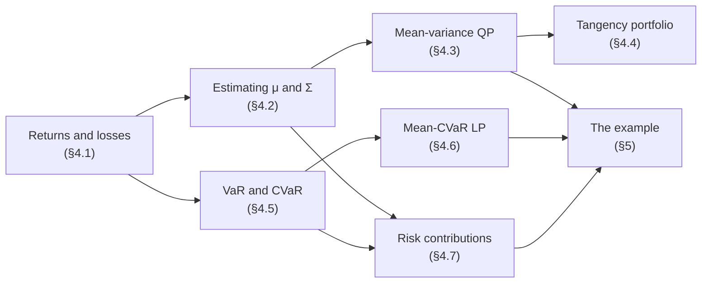
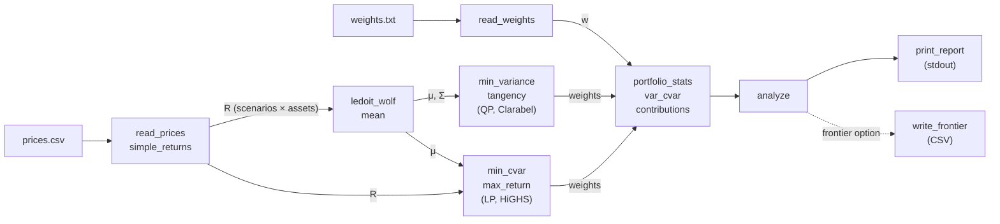
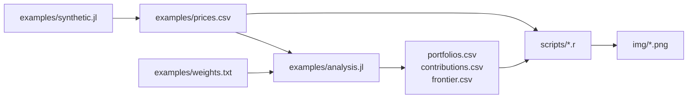
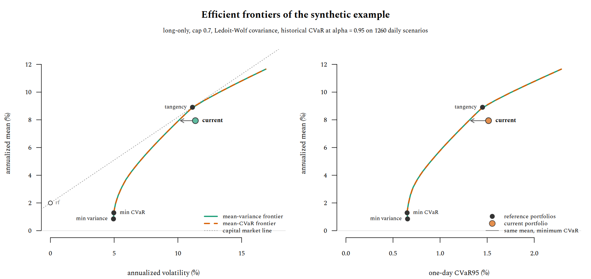
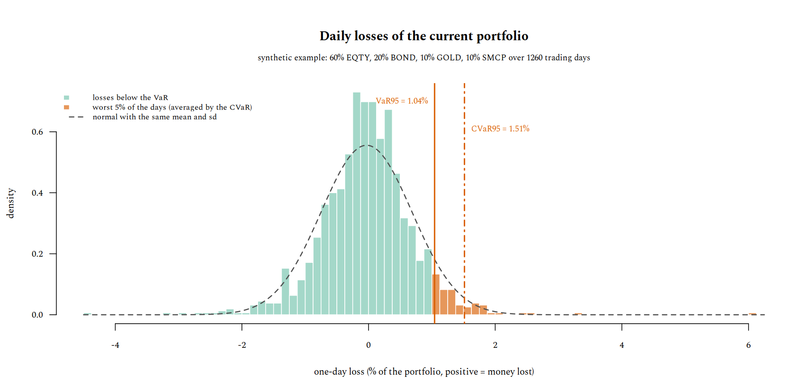
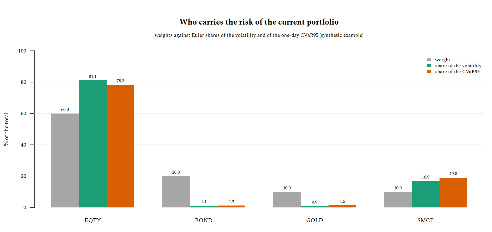

# CVaRPort: a tail-risk calculator for a small portfolio

`cvarport` takes the historical prices of a few ETFs and the amounts you hold, and answers one question: *is my portfolio efficient, and how much tail risk could I remove without giving up expected return?* It measures the portfolio you have (mean, volatility, Sharpe ratio, historical VaR and CVaR, and how much of each risk every asset carries), then compares it with the best portfolios that can be built from the same assets under the same constraints, on two efficient frontiers: Markowitz's mean-variance one and the mean-CVaR one of Rockafellar and Uryasev.

It is written in [Julia](https://julialang.org): the optimization problems are stated with [JuMP](https://jump.dev) almost as they are written below, and solved by [HiGHS](https://highs.dev) (linear programs) and [Clarabel](https://clarabel.org) (quadratic programs). The figures of this page are drawn in R from the program's own output.

> This is a study tool, not investment advice: every number it prints is an estimate from past data (see [§9](#9-caveats)).


## What you need

- **Portfolio theory**: expected return and variance of a portfolio, the efficient frontier, the tangency portfolio. The closed form of the frontier without sign constraints is derived with Lagrange multipliers in [teoria_lagrange §9.4](https://geoteo.net/geonote/matematica_statistica/teoria_lagrange.html#94-portafoglio-di-markowitz); here the weights are long-only and capped, so the closed form is replaced by a solver ([§4.3](#43-mean-variance)).
- **Convex optimization**: KKT conditions ([teoria_lagrange §5](https://geoteo.net/geonote/matematica_statistica/teoria_lagrange.html#5-vincoli-di-disuguaglianza-kkt)), linear programming and its duality ([teoria_ottimizzazione §1](https://geoteo.net/geonote/teoria_computazione/teoria_ottimizzazione.html#1-programmazione-lineare), [teoria_lagrange §8.1](https://geoteo.net/geonote/matematica_statistica/teoria_lagrange.html#81-il-duale-della-pl-dalla-lagrangiana)), interior-point methods ([teoria_lagrange §7.3](https://geoteo.net/geonote/matematica_statistica/teoria_lagrange.html#73-gradiente-proiettato-sqp-e-punti-interni)).
- **Probability**: quantiles and expected values of a loss distribution, which is all VaR and CVaR are ([§4.5](#45-var-and-cvar)).
- **R base graphics**, only to regenerate the figures ([fondamenti_r §7](https://geoteo.net/geonote/fondamenti/fondamenti_r.html#7-grafici)).




## 1. What it does

Given a prices file and a weights file, `cvarport` prints a report like this one, computed on the synthetic data set of [`examples/`](https://github.com/matteogiorgi/cvarport/tree/main/examples) (five years of daily prices of four made-up assets, [§5](#5-the-example)):

```text
cvarport: 1260 return periods, 4 assets, alpha = 0.95, cap = 0.70, Ledoit-Wolf delta = 0.017
mean and vol annualized (x252), rf = 2.00%; VaR and CVaR are one-period losses

portfolio                      mean      vol  Sharpe    VaR95   CVaR95  |     EQTY     BOND     GOLD     SMCP
current                       7.94%   11.37%   0.522    1.04%    1.51%  |    0.600    0.200    0.100    0.100
min variance                  0.85%    4.95%  -0.233    0.45%    0.65%  |    0.144    0.700    0.156    0.000
tangency                      8.90%   11.15%   0.619    0.99%    1.45%  |    0.700    0.300    0.000    0.000
min CVaR                      1.29%    4.97%  -0.143    0.45%    0.65%  |    0.167    0.700    0.133    0.000
min var, mean >= current      7.94%   10.05%   0.591    0.90%    1.31%  |    0.625    0.375    0.000    0.000
min CVaR, mean >= current     7.94%   10.05%   0.591    0.90%    1.31%  |    0.625    0.375    0.000    0.000

risk contributions of the current portfolio (shares of the total)
asset      weight      vol   CVaR95
EQTY        0.600   81.10%   78.31%
BOND        0.200    1.13%    1.19%
GOLD        0.100    0.90%    1.46%
SMCP        0.100   16.88%   19.05%

with expected return at least the current one, CVaR95 goes from 1.51% to 1.31% (-13.8% relative)
```

How to read it:

- **First table.** One row per portfolio, one column per asset weight. `current` is yours; the others are the reference portfolios, all fully invested, long-only and with no weight above the cap: minimum variance ([§4.3](#43-mean-variance)), tangency, the one with the best Sharpe ratio ([§4.4](#44-tangency-portfolio)), minimum CVaR ([§4.6](#46-minimum-cvar-as-a-linear-program)), and the two that matter most, the minimum-variance and the minimum-CVaR portfolios whose expected return is at least yours.
- **Units.** Mean and volatility are annualized, VaR and CVaR are one-period losses (here one day) at confidence `alpha`, as a fraction of the money invested ([§4.8](#48-annualization)).
- **Second table.** The share of the volatility and of the CVaR due to each asset ([§4.7](#47-risk-contributions)). A share much larger than the weight marks the assets that carry the risk.
- **Last line.** The answer to the question: here the same expected return is available with 13.8% less CVaR.

Optionally (`--frontier F`) it also writes both efficient frontiers to a CSV file, one row per point, for plotting.


## 2. Usage

Requires [Julia](https://julialang.org/downloads/) 1.10 or later. From the repository root:

```sh
julia --project=. -e 'using Pkg; Pkg.instantiate()'    # once: install JuMP, HiGHS, Clarabel
```


### 2.1 Quick start, without a network connection

```sh
julia --project=. examples/synthetic.jl > examples/prices.csv
julia --project=. bin/cvarport.jl examples/prices.csv examples/weights.txt --rf 0.02 --cap 0.7
```

The first command generates the synthetic prices; the second prints the report of [§1](#1-what-it-does). The first run takes a while longer, because Julia compiles JuMP and the solvers.


### 2.2 Your own portfolio

`cvarport` reads two plain-text files.

**Prices**, a CSV with a header `date,T1,...,Tn` and one row per date, in ascending order, with no missing values:

```text
date,AAA,BBB,CCC
2021-01-04,61.82,103.66,49.74
2021-01-05,62.05,103.71,50.12
...
```

**Weights**, one `TICKER amount` line per asset you hold, with the same tickers as the header of the prices file. Amounts can be weights or money: they are normalized to sum to one, and tickers left out weigh zero. `#` starts a comment.

```text
# TICKER amount
AAA  6000
BBB  2500
CCC  1500
```

`scripts/fetch.sh` downloads daily, weekly or monthly closes from [Stooq](https://stooq.com) and merges them into that format, keeping only the dates common to all tickers:

```sh
scripts/fetch.sh -i d TICKER1 TICKER2 TICKER3 > prices.csv    # -i d|w|m, Stooq symbols
```

Stooq may answer scripts with a browser check instead of data; when that happens, `fetch.sh` stops with an error, and the files can be downloaded from the Stooq page of each ticker and merged by hand into the format above.

Two choices make the numbers more meaningful:

- **Accumulating ETFs.** Closing prices do not include distributions, so for a distributing ETF the yield is missing from the returns.
- **One currency.** Returns are computed in the currency of the prices. A euro investor holding ETFs quoted in dollars bears an exchange-rate risk that the prices in dollars do not show; ETFs listed in euro (UCITS, on a European exchange) avoid the problem.


### 2.3 Options

```sh
julia --project=. bin/cvarport.jl prices.csv weights.txt --rf 0.025 --cap 0.6 --frontier frontier.csv
```

| option | default | meaning |
| --- | --- | --- |
| `--alpha A` | `0.95` | CVaR confidence level |
| `--rf R` | `0` | annual risk-free rate (e.g. €STR or a short BOT yield) |
| `--cap C` | `1` | maximum weight of any asset |
| `--periods P` | `252` | return periods per year: 252 daily, 52 weekly, 12 monthly |
| `--no-shrink` | off | sample covariance instead of Ledoit-Wolf |
| `--frontier F` | none | write both frontiers to the CSV file `F` |

The cap must be feasible: with $N$ assets the weights can sum to one only if $N \cdot \text{cap} \ge 1$. If the current weights exceed the cap, the report says so, and the comparison of the last line is between portfolios that live under different constraints.


### 2.4 From Julia

Everything the command line does is a function of the `CVaRPort` module, which also exposes the building blocks ([§3](#3-how-it-works)):

```julia
using CVaRPort

_, tickers, P = read_prices("examples/prices.csv")
w = read_weights("examples/weights.txt", tickers)
R = simple_returns(P)

res = analyze(R, w; alpha = 0.95, rf = 0.02, cap = 0.7)
print_report(tickers, res)

Sigma, delta = ledoit_wolf(R)
w_cvar, cvar = min_cvar(R, 0.95, Constraints(cap = 0.7))
```

[`examples/analysis.jl`](https://github.com/matteogiorgi/cvarport/blob/main/examples/analysis.jl) is a complete example: it runs the analysis of [§1](#1-what-it-does) and writes its results to CSV files instead of printing them.


## 3. How it works

The program is a straight pipeline: two files in, returns, estimates, optimization problems, a report out. Each stage lives in its own file of [`src/`](https://github.com/matteogiorgi/cvarport/tree/main/src).



1. **Data** ([`src/data.jl`](https://github.com/matteogiorgi/cvarport/blob/main/src/data.jl)). `read_prices` checks the prices file (ascending dates, positive and complete prices) and returns the price matrix $P$; `simple_returns` turns it into the returns matrix $R$, one row per period and one column per asset; `read_weights` matches the weights file against the tickers and normalizes it.
2. **Estimation** ([`src/estimate.jl`](https://github.com/matteogiorgi/cvarport/blob/main/src/estimate.jl)). The expected returns $\hat\mu$ are column means of $R$; the covariance $\hat\Sigma$ is the Ledoit-Wolf shrinkage estimator ([§4.2](#42-estimating-mu-and-sigma)).
3. **Risk** ([`src/risk.jl`](https://github.com/matteogiorgi/cvarport/blob/main/src/risk.jl)). For any weight vector: historical VaR and CVaR, risk contributions, and the annualized statistics of the report ([§4.5](#45-var-and-cvar), [§4.7](#47-risk-contributions), [§4.8](#48-annualization)).
4. **Optimization** ([`src/optim.jl`](https://github.com/matteogiorgi/cvarport/blob/main/src/optim.jl)). The constraints are a value of type `Constraints`; every problem is a JuMP model built on the same feasible set and handed to the right solver ([§6](#6-solvers-and-numerics)): quadratic programs for variance, linear programs for CVaR and for the maximum return.
5. **Report** ([`src/report.jl`](https://github.com/matteogiorgi/cvarport/blob/main/src/report.jl)). `analyze` computes the reference portfolios and their statistics into a named tuple; `print_report` formats it; `write_frontier` sweeps both frontiers and writes them to CSV.

The command line ([`bin/cvarport.jl`](https://github.com/matteogiorgi/cvarport/blob/main/bin/cvarport.jl)) only parses the options and calls these functions. Two of them have more than one method, chosen by Julia's multiple dispatch on the argument types: `var_cvar(L, alpha)` works on a vector of losses and `var_cvar(R, w, alpha)` on returns and weights, while `print_report` writes to `stdout` unless it is given an `IO` (see [teoria_tipi §13](https://geoteo.net/geonote/teoria_linguaggi/teoria_tipi.html#13-polimorfismo-nei-linguaggi) on polymorphism across languages).


## 4. The model

### 4.1 Returns, losses and constraints

There are $N$ assets and $S + 1$ dates. The return of asset $i$ in period $s$ is the simple return

$$
r_{s,i} = \frac{P_{s,i}}{P_{s-1,i}} - 1, \qquad s = 1, \dots, S,
$$

and the row $r_s \in \mathbb{R}^N$ is a *scenario*: the model takes the $S$ observed scenarios, each with probability $1/S$, as the distribution of the returns ("historical simulation"). A portfolio is a weight vector $w$, and its loss in scenario $s$ is

$$
L_s(w) = -r_s^\top w ,
$$

positive when money is lost. Simple returns, unlike log returns, aggregate exactly across assets: the return of the portfolio is $r_s^\top w$. All portfolios belong to the feasible set

$$
\mathcal{W} = \lbrace w \in \mathbb{R}^N : \mathbf{1}^\top w = 1, \ 0 \le w_i \le c \rbrace ,
$$

fully invested, long-only, with a cap $c$ on each weight; it is not empty exactly when $N c \ge 1$.


### 4.2 Estimating mu and Sigma

The expected returns are the sample means $\hat\mu = \frac{1}{S} \sum_s r_s$. They are the weakest input of the whole model: the standard error of an annual mean estimated from $Y$ years of data is about $\sigma / \sqrt{Y}$, which for an equity index (volatility around 16%) over five years is about 7% a year, as large as the mean itself. [§5](#5-the-example) shows it on the synthetic data.

The covariance is better determined, but the sample covariance

$$
C = \frac{1}{S} \sum_{s=1}^{S} x_s x_s^\top , \qquad x_s = r_s - \hat\mu ,
$$

is noisy when $S$ is not much larger than $N$, and the optimizers exploit its noise. `ledoit_wolf` shrinks it towards a multiple of the identity (Ledoit and Wolf, 2004):

$$
\hat\Sigma = \delta \, m I + (1 - \delta) \, C , \qquad m = \frac{\operatorname{tr} C}{N} .
$$

The intensity $\delta \in [0, 1]$ trades the distance of $C$ from the target against the estimation error of $C$, both measured with the normalized Frobenius norm:

$$
d^2 = \frac{1}{N} \lVert C - m I \rVert_F^2 , \qquad
\bar{b}^2 = \frac{1}{N S^2} \sum_{s=1}^{S} \lVert x_s x_s^\top - C \rVert_F^2 , \qquad
\delta = \frac{\min(\bar{b}^2, d^2)}{d^2} .
$$

With many observations $\bar{b}^2$ is small and $\delta \to 0$: on the 1260 days of the example $\delta = 0.017$, and on 20000 observations of three assets (a test) it stays below 0.05. The result is always symmetric positive definite, which the quadratic programs need. `--no-shrink` uses $C$ instead.


### 4.3 Mean-variance

The minimum-variance portfolio with expected return at least $\tau$ solves the convex quadratic program

$$
\min_{w \in \mathcal{W}} \; w^\top \hat\Sigma w \qquad \text{s.t.} \qquad \hat\mu^\top w \ge \tau .
$$

Without the sign and cap constraints, and with an equality on the return, the Lagrange conditions are linear and give the closed form of [teoria_lagrange §9.4](https://geoteo.net/geonote/matematica_statistica/teoria_lagrange.html#94-portafoglio-di-markowitz); with them, the optimum is characterized by the KKT conditions ([teoria_lagrange §5](https://geoteo.net/geonote/matematica_statistica/teoria_lagrange.html#5-vincoli-di-disuguaglianza-kkt)) and computed numerically. The tests check the solver against the closed forms on an example where the constraints are not active.

`min_variance` without a target gives the left end of the frontier. The right end is the portfolio of maximum expected return, a linear program (`max_return`): with a cap $c$, it fills the assets in decreasing order of $\hat\mu_i$ up to $c$ each. `mv_frontier` sweeps $\tau$ between the two ends.


### 4.4 Tangency portfolio

With a risk-free rate $r_f$, the tangency portfolio maximizes the Sharpe ratio

$$
\max_{w \in \mathcal{W}} \; \frac{(\hat\mu - r_f \mathbf{1})^\top w}{\sqrt{w^\top \hat\Sigma w}} ,
$$

which is not a convex problem as stated. If some feasible portfolio beats $r_f$, the change of variables $y = w / (\hat\mu - r_f \mathbf{1})^\top w$ makes it one. The constraints of $\mathcal{W}$ are homogeneous once the budget is dropped, so they carry over to $y$ as $y \ge 0$ and $y_i \le c \, \mathbf{1}^\top y$; the numerator becomes $1$, and maximizing the ratio is the same as minimizing the denominator:

$$
\min_{y} \; y^\top \hat\Sigma y \qquad \text{s.t.} \qquad (\hat\mu - r_f \mathbf{1})^\top y = 1, \quad y \ge 0, \quad y_i \le c \, \mathbf{1}^\top y ,
$$

after which $w = y / \mathbf{1}^\top y$. Here $r_f$ is per period, the annual rate divided by the number of periods per year. When no feasible portfolio beats $r_f$, `tangency` throws an error and the report leaves out the row.


### 4.5 VaR and CVaR

For a loss $L$ and a confidence level $\alpha$ (say 0.95), the *value at risk* (VaR) at level $\alpha$ is the $\alpha$-quantile of $L$: the loss exceeded only with probability $1 - \alpha$. It says nothing about how large the losses beyond it are, and it is not convex in the weights, so diversification can increase it. The *conditional value at risk* is, roughly, the average loss in the worst $(1 - \alpha)$ fraction of the cases, and Rockafellar and Uryasev (2000, 2002) characterized it as the value of a one-dimensional minimization:

$$
\operatorname{CVaR}_\alpha(L) = \min_{\zeta \in \mathbb{R}} \; \Big( \zeta + \frac{1}{1 - \alpha} \, \mathbb{E}\big[ \max(L - \zeta, 0) \big] \Big) ,
$$

whose minimizer is the VaR. CVaR is convex and coherent (subadditive: a combination of portfolios is never riskier than the combination of their risks), which is what makes it optimizable.

With $S$ equally likely scenarios, the expectation is a mean, and the historical CVaR of the portfolio $w$ is

$$
\operatorname{CVaR}_\alpha(w) = \min_{\zeta} \; \Big( \zeta + \frac{1}{(1 - \alpha) S} \sum_{s=1}^{S} \max\big( L_s(w) - \zeta, 0 \big) \Big) .
$$

The objective is piecewise linear and convex in $\zeta$, with slope changing at the losses: its minimum is at the $k$-th smallest loss, $k = \lceil \alpha S \rceil$, which is the historical VaR. `var_cvar` evaluates exactly this expression. When $(1 - \alpha) S$ is not an integer the VaR scenario enters the average with a fractional weight: for the ten losses $1, 2, \dots, 10$ and $\alpha = 0.75$, the worst $2.5$ scenarios give $\operatorname{VaR} = 8$ and $\operatorname{CVaR} = (10 + 9 + 0.5 \cdot 8) / 2.5 = 9.2$ (one of the tests).


### 4.6 Minimum CVaR as a linear program

The formula of [§4.5](#45-var-and-cvar) is jointly convex in $(w, \zeta)$, so minimizing CVaR over the portfolios is a single minimization over $w$ and $\zeta$ together. Each $\max(\cdot, 0)$ becomes an auxiliary variable $u_s$ with two linear constraints, and the problem is the linear program

$$
\min_{w \in \mathcal{W}, \ \zeta, \ u} \; \zeta + \frac{1}{(1 - \alpha) S} \sum_{s=1}^{S} u_s
\qquad \text{s.t.} \qquad
u_s \ge -r_s^\top w - \zeta, \quad u_s \ge 0, \quad \hat\mu^\top w \ge \tau .
$$

At the optimum each $u_s$ is as small as allowed, $u_s = \max(L_s(w) - \zeta, 0)$, so the objective is the historical CVaR of the optimal portfolio and $\zeta$ is its VaR: the optimizer and the report use the same definition, and the tests check that they agree. The program has $N + 1 + S$ variables and grows with the number of scenarios (1265 variables for the example), which a simplex solver handles without effort ([teoria_ottimizzazione §1](https://geoteo.net/geonote/teoria_computazione/teoria_ottimizzazione.html#1-programmazione-lineare); its dual, read through the Lagrangian, is in [teoria_lagrange §8.1](https://geoteo.net/geonote/matematica_statistica/teoria_lagrange.html#81-il-duale-della-pl-dalla-lagrangiana)). `min_cvar` without a target gives the minimum-CVaR portfolio, and `cvar_frontier` sweeps $\tau$ as in [§4.3](#43-mean-variance).


### 4.7 Risk contributions

Volatility and CVaR are positively homogeneous of degree one, $\rho(t w) = t \rho(w)$ for $t > 0$: doubling every position doubles the risk. By Euler's theorem on homogeneous functions, such a $\rho$ is the sum of its marginal contributions,

$$
\rho(w) = \sum_{i=1}^{N} w_i \frac{\partial \rho}{\partial w_i}(w) ,
$$

and $c_i = w_i \, \partial \rho / \partial w_i$ is the part of the risk due to asset $i$ (Tasche, 2008). For the volatility $\sigma(w) = \sqrt{w^\top \hat\Sigma w}$ the gradient is $\hat\Sigma w / \sigma(w)$, so

$$
c_i^{\sigma} = \frac{w_i \, (\hat\Sigma w)_i}{\sigma(w)} .
$$

For the historical CVaR, let $s^\star$ be the scenario of the VaR, $\zeta^\star = L_{s^\star}(w)$, $\mathcal{T} = \lbrace s : L_s(w) > \zeta^\star \rbrace$ the scenarios beyond it, and $m = (1 - \alpha) S$. Then

$$
\frac{\partial \operatorname{CVaR}_\alpha}{\partial w_i}
= \frac{1}{m} \Big( \sum_{s \in \mathcal{T}} (-r_{s,i}) + \big( m - \lvert \mathcal{T} \rvert \big) (-r_{s^\star,i}) \Big) ,
$$

the average loss of asset $i$ over the tail scenarios, with the same fractional weight on the VaR scenario as in [§4.5](#45-var-and-cvar). Both decompositions add up exactly to the total (the tests check it to $10^{-12}$), and the report prints the shares $c_i / \sum_j c_j$. A share can be negative: an asset that tends to gain when the portfolio loses reduces the risk.


### 4.8 Annualization

With $p$ periods per year (`--periods`), the report annualizes linearly, as is customary for simple returns:

$$
\text{mean} = p \, \hat\mu^\top w , \qquad \text{vol} = \sqrt{p} \, \sigma(w) , \qquad \text{Sharpe} = \frac{\text{mean} - r_f}{\text{vol}} .
$$

VaR and CVaR stay one-period: scaling them by $\sqrt{p}$ would assume normal, independent returns, which is exactly what the tail measures are meant not to assume.


## 5. The example

The synthetic data set ([`examples/synthetic.jl`](https://github.com/matteogiorgi/cvarport/blob/main/examples/synthetic.jl)) has four assets over 1260 trading days: an equity index (`EQTY`), a bond index (`BOND`), gold (`GOLD`) and small caps (`SMCP`, correlated 0.8 with `EQTY`). The daily returns are drawn from a multivariate Student $t$ with 4 degrees of freedom, so they have fat tails, and the figures below come from the program itself:



The example also shows the weakness of $\hat\mu$ ([§4.2](#42-estimating-mu-and-sigma)). The returns are generated with annual drifts of 7%, 2%, 4% and 9%, but over these five simulated years the sample means come out at 12.7%, 0.0%, $-6.1\%$ and 9.1%: gold, built to earn 4% a year, *lost* 6% a year in this sample. Every optimizer below takes these estimates at face value.


### 5.1 The frontiers



The current portfolio (60% `EQTY`, 20% `BOND`, 10% `GOLD`, 10% `SMCP`) lies inside both frontiers. Keeping its expected return of 7.94%, the minimum-CVaR portfolio takes the one-day CVaR95 from 1.51% to 1.31% and the volatility from 11.4% to 10.1%, by holding 62.5% `EQTY` and 37.5% `BOND` and nothing else: gold goes because of its negative sample mean, small caps because they add volatility to equity without adding return. The tangency portfolio sits where the capital market line from $r_f = 2\%$ touches the mean-variance frontier, at the cap on `EQTY`.

The two frontiers coincide, and they should. The Student $t$ used here is *elliptical*: every portfolio return has the same distribution up to its mean and scale, so any risk measure that is translation invariant and positively homogeneous, VaR and CVaR included, is a function of the mean and of the volatility of the portfolio, and ranks portfolios as variance does. For elliptical returns, Markowitz is optimal for CVaR too (Embrechts, McNeil and Straumann, 2002); the residual gap in the figure is sampling noise of the historical CVaR. The frontiers separate when the joint distribution is not elliptical: assets with skewed returns, such as options or credit, or crashes that hit several assets at once more often than their correlation suggests. That is when `cvarport`'s second frontier says something the first one cannot.


### 5.2 The losses



The orange bars are the worst 5% of the days, whose average (with the fractional weight of [§4.5](#45-var-and-cvar)) is the CVaR. Against the normal distribution with the same mean and standard deviation, the losses are more concentrated around zero and have a longer tail: the normal model gives a *larger* VaR (1.15% against 1.04%) but a *smaller* CVaR (1.45% against 1.51%), and the sample has 4 losses beyond three standard deviations, where a normal would expect 1.7, the largest at 6.0%. This is why `cvarport` uses the historical scenarios rather than a normal approximation.


### 5.3 The risk contributions



`EQTY` holds 60% of the money and 78-81% of the risk; `SMCP`, with 10% of the money, carries 17-19%, because it moves with `EQTY` and is more volatile. `BOND` and `GOLD` together hold 30% of the money and about 2-3% of the risk: they are almost uncorrelated with the equity assets, so their marginal contribution is small. The CVaR shares are close to the volatility shares, as expected from the elliptical model of [§5.1](#51-the-frontiers); with real data the gap between the two columns is where tail risk hides.


## 6. Solvers and numerics

- **Two solvers.** The linear programs (`max_return`, `min_cvar`) go to HiGHS, a dual simplex solver; the quadratic programs (`min_variance`, `tangency`) go to Clarabel, an interior-point solver ([teoria_lagrange §7.3](https://geoteo.net/geonote/matematica_statistica/teoria_lagrange.html#73-gradiente-proiettato-sqp-e-punti-interni)). HiGHS also solves quadratic programs, with an active-set method, but on the covariances of daily returns, whose entries are of order $10^{-4}$, it stalled indefinitely, and at the right end of a frontier, where the feasible set shrinks to almost a single point, it failed; the interior-point method does not have either problem.
- **Scaling.** Before a quadratic program is solved, $\hat\Sigma$ is divided by its average variance $\operatorname{tr} \hat\Sigma / N$. The minimizer does not change, but the objective becomes of order one, so the solver's absolute tolerances mean the same for daily and for annual returns. Without it, two solutions of the same problem reached by different routes differed in the third decimal of the weights.
- **Cleaning.** Solutions are clipped at zero and renormalized to sum to one, removing solver noise of order $10^{-8}$.
- **Frontier ends.** The last target of a frontier is moved slightly below the maximum return, so the solver is never asked for a feasible set reduced to a single point.


## 7. Project layout

- [`Project.toml`](https://github.com/matteogiorgi/cvarport/blob/main/Project.toml), [`Manifest.toml`](https://github.com/matteogiorgi/cvarport/blob/main/Manifest.toml) — package definition, dependencies (JuMP, HiGHS, Clarabel, and three standard libraries) and their exact versions.
- [`src/CVaRPort.jl`](https://github.com/matteogiorgi/cvarport/blob/main/src/CVaRPort.jl) — the module: imports, exports, and the order in which the other files are included.
- [`src/data.jl`](https://github.com/matteogiorgi/cvarport/blob/main/src/data.jl) — `read_prices`, `read_weights`, `simple_returns`: the two input formats and the returns matrix ([§2.2](#22-your-own-portfolio), [§4.1](#41-returns-losses-and-constraints)).
- [`src/estimate.jl`](https://github.com/matteogiorgi/cvarport/blob/main/src/estimate.jl) — `ledoit_wolf`, the shrinkage covariance ([§4.2](#42-estimating-mu-and-sigma)).
- [`src/risk.jl`](https://github.com/matteogiorgi/cvarport/blob/main/src/risk.jl) — `var_cvar`, `cvar_contributions`, `vol_contributions`, `portfolio_stats` ([§4.5](#45-var-and-cvar), [§4.7](#47-risk-contributions), [§4.8](#48-annualization)).
- [`src/optim.jl`](https://github.com/matteogiorgi/cvarport/blob/main/src/optim.jl) — `Constraints`, `min_variance`, `max_return`, `tangency`, `min_cvar`, `mv_frontier`, `cvar_frontier`, and the solver plumbing of [§6](#6-solvers-and-numerics) ([§4.3](#43-mean-variance)–[§4.6](#46-minimum-cvar-as-a-linear-program)).
- [`src/report.jl`](https://github.com/matteogiorgi/cvarport/blob/main/src/report.jl) — `analyze`, `print_report`, `write_frontier` ([§1](#1-what-it-does)).
- [`bin/cvarport.jl`](https://github.com/matteogiorgi/cvarport/blob/main/bin/cvarport.jl) — the command line ([§2.3](#23-options)).
- [`test/runtests.jl`](https://github.com/matteogiorgi/cvarport/blob/main/test/runtests.jl) — the test suite ([§8](#8-tests)).
- [`scripts/fetch.sh`](https://github.com/matteogiorgi/cvarport/blob/main/scripts/fetch.sh) — POSIX shell script that downloads closes from Stooq and merges them ([§2.2](#22-your-own-portfolio)).
- [`scripts/frontiers.r`](https://github.com/matteogiorgi/cvarport/blob/main/scripts/frontiers.r), [`scripts/losses.r`](https://github.com/matteogiorgi/cvarport/blob/main/scripts/losses.r), [`scripts/contributions.r`](https://github.com/matteogiorgi/cvarport/blob/main/scripts/contributions.r) — the R scripts drawing the figures of [§5](#5-the-example) into [`img/`](https://github.com/matteogiorgi/cvarport/tree/main/img).
- [`examples/`](https://github.com/matteogiorgi/cvarport/tree/main/examples) — the synthetic data set: its generator `synthetic.jl`, the prices and weights, `analysis.jl` and the CSV files it writes.
- [`LICENSE`](https://github.com/matteogiorgi/cvarport/blob/main/LICENSE) — MIT.
- [`_config.yml`](https://github.com/matteogiorgi/cvarport/blob/main/_config.yml) — the GitHub-Pages configuration: this page inherits layout, MathJax and Mermaid from [geoteo.net](https://geoteo.net) (see [tema_geoteo](https://geoteo.net/geonote/strumenti_curiosita/tema_geoteo.html)).

To regenerate the example and the figures, from the repository root:

```sh
julia --project=. examples/synthetic.jl > examples/prices.csv
julia --project=. examples/analysis.jl
Rscript scripts/frontiers.r
Rscript scripts/losses.r
Rscript scripts/contributions.r
```

The R scripts use base graphics only, and the [Spectral](https://fonts.google.com/specimen/Spectral) font of this page through the Cairo device.


## 8. Tests

```sh
julia --project=. -e 'using Pkg; Pkg.test()'
```

The 38 checks, grouped by test set, cover:

- **`var_cvar` by hand**: the worked examples of [§4.5](#45-var-and-cvar), and agreement with a brute-force minimization over $\zeta$.
- **Euler contributions**: both decompositions of [§4.7](#47-risk-contributions) add up to the total.
- **Ledoit-Wolf**: $\delta \in [0, 1]$, a symmetric positive definite result, little shrinkage with plenty of data.
- **Closed forms**: minimum variance and tangency against $\Sigma^{-1} \mathbf{1}$ and $\Sigma^{-1} (\mu - r_f \mathbf{1})$, normalized, when the constraints are not active; the capped tangency has a Sharpe ratio between the equal-weight portfolio's and the unconstrained one's.
- **Minimum CVaR**: the LP value equals the historical CVaR of its solution, and is no larger than that of the equal-weight and of the minimum-variance portfolios; an infeasible cap is rejected.
- **Frontiers**: risk is non-decreasing along both frontiers and every point meets its target.
- **`analyze`** and **file formats**: the report, the parsers, and the frontier CSV.

The scenarios of the tests are correlated Student $t$ returns of daily size, generated with a fixed seed.


## 9. Caveats

- **History is the model.** The scenarios are the observed returns and nothing else: a crash that is not in the sample does not exist for `cvarport`. Short samples give unstable frontiers, mostly through $\hat\mu$ ([§5](#5-the-example)).
- **In-sample optimization.** The reference portfolios are optimal on the same data used to evaluate them, so their advantage over the current portfolio is optimistic.
- **Linear annualization** of mean and volatility, one-period VaR and CVaR ([§4.8](#48-annualization)).
- **Prices, not total returns.** Distributions and currency effects are only as good as the prices supplied ([§2.2](#22-your-own-portfolio)).
- **Different calendars.** Merging assets listed on exchanges with different holidays keeps only the common dates, so some returns span more than one day.


## References

- H. Markowitz, «Portfolio Selection», *The Journal of Finance*, 7(1), 1952, 77–91: the mean-variance problem ([§4.3](#43-mean-variance)).
- R. T. Rockafellar, S. Uryasev, «Optimization of Conditional Value-at-Risk», *Journal of Risk*, 2(3), 2000, 21–41, and «Conditional value-at-risk for general loss distributions», *Journal of Banking & Finance*, 26(7), 2002, 1443–1471: the CVaR formula and its linear program ([§4.5](#45-var-and-cvar), [§4.6](#46-minimum-cvar-as-a-linear-program)).
- O. Ledoit, M. Wolf, «A well-conditioned estimator for large-dimensional covariance matrices», *Journal of Multivariate Analysis*, 88(2), 2004, 365–411: the shrinkage estimator ([§4.2](#42-estimating-mu-and-sigma)).
- D. Tasche, «Capital Allocation to Business Units and Sub-Portfolios: the Euler Principle», 2008, [arXiv:0708.2542](https://arxiv.org/abs/0708.2542): risk contributions ([§4.7](#47-risk-contributions)).
- P. Embrechts, A. McNeil, D. Straumann, «Correlation and dependence in risk management: properties and pitfalls», in *Risk Management: Value at Risk and Beyond*, Cambridge University Press, 2002, 176–223: elliptical distributions and the coincidence of the frontiers ([§5.1](#51-the-frontiers)).
- Q. Huangfu, J. A. J. Hall, «Parallelizing the dual revised simplex method», *Mathematical Programming Computation*, 10, 2018, 119–142: HiGHS ([§6](#6-solvers-and-numerics)).
- P. J. Goulart, Y. Chen, «Clarabel: An interior-point solver for conic programs with quadratic objectives», 2024, [arXiv:2405.12762](https://arxiv.org/abs/2405.12762): Clarabel ([§6](#6-solvers-and-numerics)).
